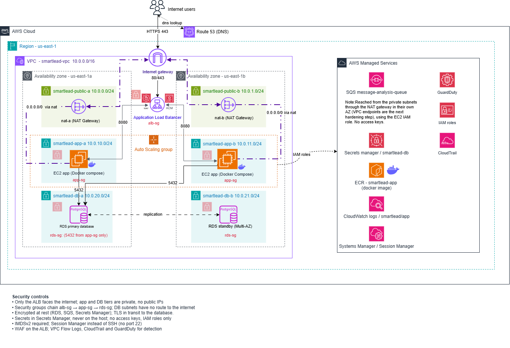

# Smart Lead Application on AWS

An application used to filter for genuine sales leads that can be followed up. The application uses 'Hugging face' api to filter the leads, it places genuine leads on SQS and eventually the databases
non-relevant sales leads do not reach the queue. 

**The brief:** a developer handed me the source code for a Spring Boot API and asked me to package it as a container image and make it accessible online reliably and hosted on AWS. The solution helps the sales team
get to qualified leads and convert those leads into revenue faster.

**What I did as the cloud/platform architect & engineer:**

- **Analysed the application** from its `pom.xml` and source: Java 21, PostgreSQL and SQS dependencies, port 8080, a health endpoint, configuration through environment variables.
- **Packaged it from scratch** into a docker container image with a [multi-stage Dockerfile](../09-capstone-smart-lead/Dockerfile).
- **Designed the AWS platform** the application needs, and built manually in AWS at first and through Infrastructure as code using Terraform once proven.
- **Automated delivery** with GitHub Actions, with no AWS keys stored anywhere using Open Identity Connect.

The whole environment (57 resources) builds from one button press in about 10 minutes and tears down with one command. Live at `https://smartlead.cloudenglabs.dev` while the lab is up (I destroy it between sessions to control cost).

## Architecture

A visitor reaches the app over HTTPS through the WAF and a load balancer. The app runs on Auto Scaling instances in private subnets and uses a managed PostgreSQL database and an SQS queue. Secrets come from Secrets Manager, never from the code.

| Tier | Reachable from |
| --- | --- |
| Public subnets (load balancer) | The internet, ports 80 and 443 only |
| App subnets (EC2) | The load balancer only, port 8080, internet via NAT gateway only |
| Database subnets (RDS) | The app only, port 5432, no internet route |

Built in layers, each verified before the next: [network and security groups](terraform/network.tf), [data](terraform/database.tf), [compute](terraform/compute.tf), [edge with HTTPS and WAF](terraform/edge.tf), then the pipelines. Full detail: [deep dive](docs/deep-dive.md).

## CI/CD

| Workflow | What it does |
| --- | --- |
| [`terraform.yml`](../../.github/workflows/terraform.yml) | Format check, validate and plan on every pull request. Apply runs only when I trigger it manually from `main` branch |
| [`app.yml`](../../.github/workflows/app.yml) | Builds the image on every pull request; on merge, pushes it to ECR tagged with the commit hash |

A release is a one-line change to the image tag in `terraform.tfvars`, so every deployed version is a commit I can revert. The Auto Scaling group replaces instances one at a time, and each must pass the load balancer health check first.

**Security controls in place:**

- **OIDC federation, no stored keys.** GitHub gets a short-lived token per run, and the AWS role trusts only this repository (by immutable IDs) on `main` or pull requests.
- **Least privilege in the workflow:** `contents: read` and `id-token: write` only.
- **Changes are visible before they happen:** plan on every pull request, manual apply from `main`, serialised runs with a state lock.
- **No secrets in the repo.** The database password is generated and held in Secrets Manager. State is in a private, versioned, encrypted s3 bucket.
- **Traceable images:** tagged by commit, scanned on push. Fork pull requests cannot get a cloud token.

**Gaps I know about:** the lab role has `AdministratorAccess`, `main` has no branch protection yet, and third-party actions are pinned to version tags, not hashes. The fix is split plan and apply roles, required reviews, code owners and an approval gate. See the [full security table](docs/deep-dive.md#pipeline-security-what-i-did-and-what-i-know-is-missing).

## Trade-offs

| Choice | Why | Production alternative |
| --- | --- | --- |
| One NAT gateway, single-AZ database | Cost | One per AZ, Multi-AZ RDS |
| Docker Compose on EC2 | Mirrors how the app ran locally | ECS on Fargate |
| Manual apply, not auto on merge | A merge cannot rebuild billing resources by accident | Auto to dev, approval for prod |
| Admin-level pipeline role | Speed in a lab | Scoped roles with a permissions boundary |
| One environment | One I could fully explain, and cost | Dev, staging and prod |

## Challenges

- **OIDC login failed** with a trust error. I printed the token's claims and found GitHub's subject includes numeric IDs my policy lacked.
- **Load balancer returned `503` over a healthy app.** I walked the chain and found nothing registered in the target group, because an edited tf file was unsaved.
- **New instances had no app:** `terraform destroy` had deleted the image registry. It now survives teardowns.
- **CI would have failed on `mvnw`:** Windows does not track the execute bit.

All eight are in the [deep dive](docs/deep-dive.md#challenges-and-how-i-solved-them).

## What I would do next

1. **Move from EC2 to ECS on Fargate.** Serverless containers with nothing to patch, scaling tasks automatically with demand and replacing failures. The database, queue, secrets, network and WAF carry over unchanged.
2. **Dev, staging and prod workflow.** Build the image once and promote the same image through each environment, with separate accounts, per-environment variables and state, a GitHub Environment per stage, and an approval before prod. [The plan](docs/deep-dive.md#environments-and-promotion-the-gap-and-the-plan).
3. Tests in CI, blue/green releases, CloudWatch alarms, multi-AZ resilience.

## Evidence and running it

Screenshots of the live run: [HTTPS health check](docs/images/https-health.png), [pipeline apply](docs/images/pipeline-apply.png), [pull request checks](docs/images/pr-checks.png), [running image](docs/images/running-image.png). Commands to build and tear it down are in the [deep dive](docs/deep-dive.md#how-to-run-it).

*Part of my [DevOps learning journey](../../my-journey/progress.md). I built this step by step. I am working towards a cloud or platform engineering & architect career.
